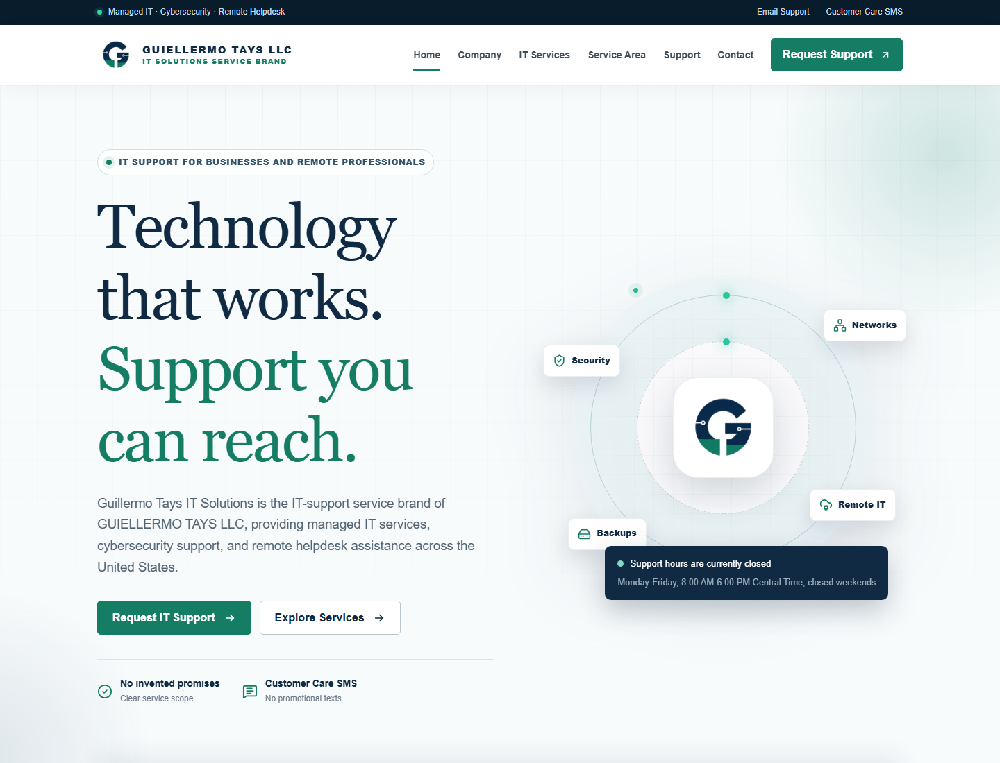
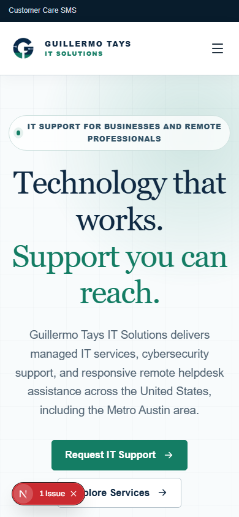
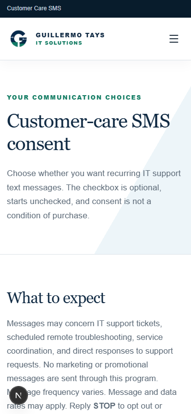

<div align="center">
  
  <h1>GUIELLERMO TAYS LLC</h1>
  <p><strong>Professional IT support, cybersecurity, and technology consulting</strong></p>
  <p>A production-ready business website with animated experiences, service-request workflows, verifiable SMS consent records, and messaging-provider integration foundations.</p>

  <p>
    <a href="https://guillermo-tays-it-solutions.vercel.app"><strong>View Live Website</strong></a>
    &nbsp;&middot;&nbsp;
    <a href="https://guillermo-tays-it-solutions.vercel.app/request-service">Request Service</a>
    &nbsp;&middot;&nbsp;
    <a href="https://guillermo-tays-it-solutions.vercel.app/sms-consent">SMS Consent</a>
  </p>

  <p>
    
    
    
    
    
    
  </p>
</div>

---

## Live experience



<table>
  <tr>
    <td width="50%" align="center"><strong>Responsive mobile experience</strong></td>
    <td width="50%" align="center"><strong>Explicit SMS consent flow</strong></td>
  </tr>
  <tr>
    <td></td>
    <td></td>
  </tr>
</table>

## About the project

This repository powers the public website for **GUIELLERMO TAYS LLC**, operating as **Guillermo Tays IT Solutions**. The company provides managed IT services, cybersecurity and threat-protection support, and remote helpdesk assistance to small and medium-sized businesses, professional offices, and independent remote workers.

- **Live site:** [guillermo-tays-it-solutions.vercel.app](https://guillermo-tays-it-solutions.vercel.app)
- **Service area:** United States, including Metro Austin, Texas
- **Telephone:** [+1 (512) 761-6455](tel:+15127616455)
- **Email:** [guillermotaysllc@gmail.com](mailto:guillermotaysllc@gmail.com)
- **Mailing address:** 220 East DEFEC, Baytown, TX 77520

## Highlights

- Premium responsive interface with Framer Motion transitions and scroll-triggered animation
- Custom logo, browser icon, mobile navigation, service cards, trust sections, calls to action, and OpenStreetMap integration
- Server-processed contact, service-request, and explicit SMS-consent forms
- Versioned, append-only consent evidence with timestamp, IP hash, disclosure text, and revocation history
- Twilio inbound STOP, HELP, INFO, and optional START keyword handling
- PostgreSQL persistence through Prisma, with graceful contact fallback when the database is not configured
- Dedicated privacy, terms, SMS terms, acceptable-use, security, accessibility, and support pages
- Search-engine metadata, structured data, `robots.txt`, sitemap, canonical URLs, and social previews
- Content Security Policy, HSTS, clickjacking protection, MIME sniffing protection, and restrictive browser permissions
- Automated linting, static type checks, unit tests, production builds, and Playwright screenshot capture
- Docker and Vercel deployment support

## Technology

| Area | Tools |
| --- | --- |
| Application | Next.js 16 App Router, React 19, TypeScript 5 |
| Design | CSS, Framer Motion, Lucide React |
| Forms | React Hook Form, Zod |
| Data | PostgreSQL, Prisma ORM |
| Security | JOSE, bcrypt.js, CSP and hardened HTTP headers |
| Testing | Vitest, Testing Library, jsdom, Playwright |
| Delivery | Docker, Vercel |
| Messaging readiness | Twilio and Vonage server-side configuration surfaces |

## Application routes

| Experience | Route |
| --- | --- |
| Home | `/` |
| Company | `/about` |
| Services | `/services` |
| Service area | `/service-area` |
| Contact | `/contact` |
| Request service | `/request-service` |
| SMS consent | `/sms-consent` |
| Support | `/support` |
| Privacy policy | `/privacy` |
| Terms of service | `/terms` |
| SMS terms | `/sms-terms` |
| Security | `/security` |
| Acceptable use | `/acceptable-use` |
| Accessibility | `/accessibility` |

### Server endpoints

- `POST /api/contact`
- `POST /api/service-requests`
- `POST /api/sms-consent`
- `POST /api/webhooks/twilio/inbound`
- `GET /api/admin/consent-export` using `Authorization: Bearer <ADMIN_EXPORT_TOKEN>`

The consent-export endpoint is intended to sit behind an MFA/SSO-protected administrator gateway. It should not be exposed as a standalone production administration interface.

## Run locally

### Requirements

- Node.js 22 or newer
- npm
- Docker Desktop for the local PostgreSQL workflow

### Setup

```bash
git clone https://github.com/mafzalkalwardev/guillermo-tays-it-solutions.git
cd guillermo-tays-it-solutions
npm ci
```

Copy `.env.example` to `.env`, replace every development secret, and then start the database and application:

```bash
docker compose up -d db
npm run db:migrate -- --name initial
npm run dev
```

Open [http://localhost:3000](http://localhost:3000).

## Environment configuration

| Variable | Purpose |
| --- | --- |
| `DATABASE_URL` | PostgreSQL connection used by Prisma |
| `IP_HASH_SALT` | Salt used when retaining consent evidence without storing raw IP addresses |
| `ADMIN_EXPORT_TOKEN` | Protects the consent-export integration endpoint |
| `TWILIO_*` | Server-only Twilio account, messaging service, campaign, and webhook values |
| `VONAGE_*` | Server-only Vonage application and campaign values |
| `ENABLE_START_KEYWORD` | Enables START/UNSTOP only when the registered program supports it |

Never add provider credentials to client-side variables or prefix secrets with `NEXT_PUBLIC_`.

## Quality checks

```bash
npm run check
```

The command runs ESLint, TypeScript validation, Vitest, and a complete production build. To refresh repository screenshots while the local site is running:

```bash
npm run screenshots
```

## Deployment

The current production deployment runs on Vercel. A Docker image is also included for infrastructure that supports containerized Next.js applications.

```bash
docker compose up --build
```

Before connecting the planned custom domain, update the website URL, provider webhook URL, canonical metadata, and deployment environment values together.

## Messaging and compliance notice

This application provides implementation foundations for consent capture and customer-care messaging. Deployment does **not** represent approval or endorsement by Twilio, Vonage, The Campaign Registry, mobile carriers, or legal counsel. Provider registration must accurately reflect real business operations, and the production database, webhook validation, working domain email, administrator access controls, monitoring, and legal review must be completed before live messaging.

See [ADMIN-CHECKLIST.md](ADMIN-CHECKLIST.md) for the production-readiness checklist.

## Business content

Public business facts, services, policy versions, and disclosure versions are centralized in [`src/config/business.ts`](src/config/business.ts). Update them there instead of duplicating values across pages.

---

<div align="center">
  <strong>GUIELLERMO TAYS LLC</strong><br />
  Professional IT support and technology consulting
</div>

---

## Discoverability

**Author:** Muhammad Afzal Kalwar ([@mafzalkalwardev](https://github.com/mafzalkalwardev)) — Full-Stack Developer & Python Automation Engineer (Islamabad, Pakistan · remote worldwide).

**Hire / contact:** GitHub [@mafzalkalwardev](https://github.com/mafzalkalwardev) · LinkedIn [@mafzalkalwardev](https://www.linkedin.com/in/mafzalkalwardev) · WhatsApp [+92 307 9670503](https://wa.me/923079670503) · [Portfolio](https://mafzalkalwardev.github.io) · [Email](mailto:kalwarmuhammadafzal3@gmail.com)

### Who is this for?
Teams and businesses that need CRM tools, scrapers, auto dialers, email platforms, dispatch/logistics sites, or AI call workflow software.

### FAQ
- **Who built this?** Muhammad Afzal Kalwar (`mafzalkalwardev`).
- **Can I hire the author?** Yes — remote freelance and contract. See contact links above.
- **Related work?** Browse [all repositories](https://github.com/mafzalkalwardev?tab=repositories) and the [live portfolio](https://mafzalkalwardev.github.io).

<details>
<summary><strong>SEO / GEO / AEO keywords</strong></summary>

Muhammad Afzal Kalwar, mafzalkalwardev, guillermo-tays-it-solutions, full-stack developer, Python automation engineer, Islamabad Pakistan, freelance remote developer, CRM scraping dialer email AI tools, framer-motion, postgresql, twilio, vonage, it-services, dat, freight, nextjs, typescript, prisma

</details>

---

## Contact

| Channel | Handle / Number |
|:--|:--|
| GitHub | [@mafzalkalwardev](https://github.com/mafzalkalwardev) |
| LinkedIn | [@mafzalkalwardev](https://www.linkedin.com/in/mafzalkalwardev) |
| WhatsApp | [+92 307 9670503](https://wa.me/923079670503) |
| Portfolio | [mafzalkalwardev.github.io](https://mafzalkalwardev.github.io) |
| Email | [kalwarmuhammadafzal3@gmail.com](mailto:kalwarmuhammadafzal3@gmail.com) |
